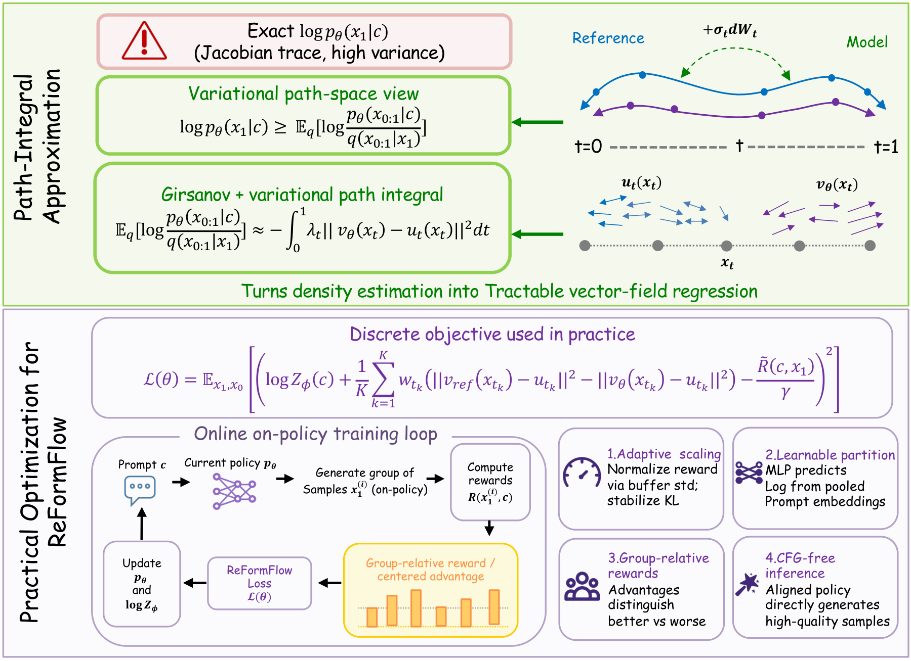
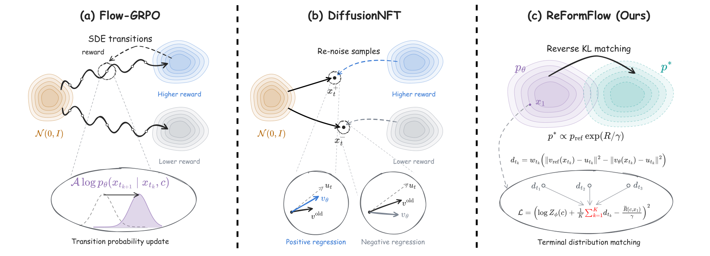
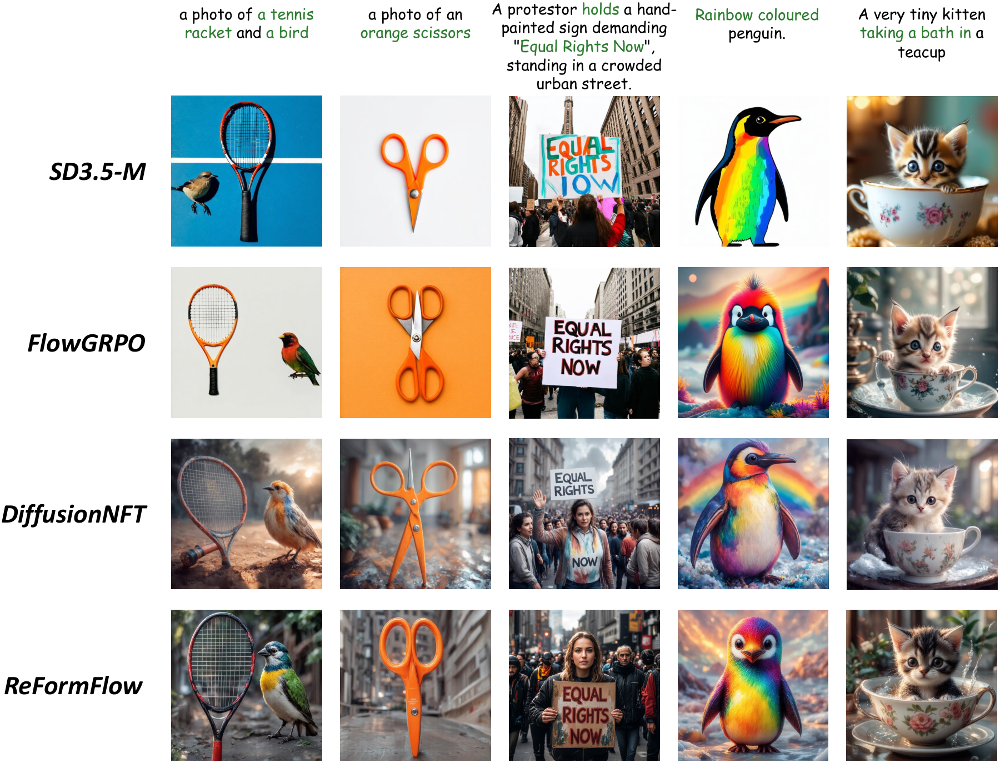
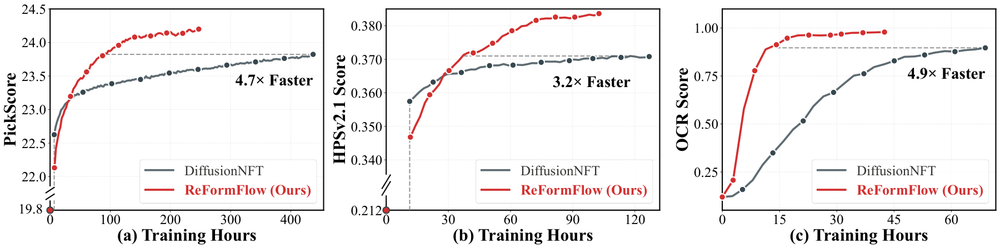

<h1 align="center">ReFormFlow</h1>
<p align="center"><strong>Reforming Flow Reinforcement via Directly Matching Reward Distributions</strong></p>

## Overview

ReFormFlow optimizes image flow models by regressing a model-to-reference terminal density-ratio surrogate toward a reward-derived target. It collects clean endpoints with the current policy, re-noises them at training timesteps, and combines velocity-regression error differences across timesteps before applying a squared reward-matching residual. An auxiliary prompt-conditioned log-normalization head is trained alongside the policy.

- **Trajectory-aggregated reward matching:** Terminal reward supervision acts on the combined timestep contributions, rather than a separate squared residual at each timestep.
- **Re-noised endpoint supervision:** Training uses clean generated samples and fresh noise instead of evaluating likelihoods along their generation trajectories.
- **Group-relative reward scaling:** Within-prompt reward centering, standard-deviation scaling and clipping stabilize the regression targets.

The density-ratio estimate is a practical surrogate; this repository does not claim exact terminal-density evaluation. SD3.5-Medium and FLUX.1-dev training are included.

## Method and Results

<p align="center"></p>
<p align="center"></p>
<p align="center"></p>
<p align="center"></p>

Figures are reproduced from the manuscript. Their PDF sources are included in [assets](assets).

## Environment Setup

### Installation

Run commands from the repository root:

```bash
conda create -n ReFormFlow python=3.10.16 -y
conda activate ReFormFlow
pip install torch==2.6.0 torchvision==0.21.0 \
  --index-url https://download.pytorch.org/whl/cu124
pip install -e .
```

Building FlashAttention requires a compatible CUDA toolkit and compiler. The installation package is `reformflow`; the Python import namespace remains `flow_grpo`.

### Model Preparation

Use [SD3.5-Medium](https://huggingface.co/stabilityai/stable-diffusion-3.5-medium) or [FLUX.1-dev](https://huggingface.co/black-forest-labs/FLUX.1-dev). Configurations default to these model identifiers. To use local Diffusers directories:

```bash
export SD3_MODEL="/path/to/stable-diffusion-3.5-medium"
export FLUX_MODEL="/path/to/FLUX.1-dev"
```

### Reward Preparation

Download the checkpoints needed by your rewards to `reward_ckpts/`:

```bash
mkdir -p reward_ckpts
(
  cd reward_ckpts || exit 1
  wget https://github.com/christophschuhmann/improved-aesthetic-predictor/raw/refs/heads/main/sac+logos+ava1-l14-linearMSE.pth
  wget https://download.openmmlab.com/mmdetection/v2.0/mask2former/mask2former_swin-s-p4-w7-224_lsj_8x2_50e_coco/mask2former_swin-s-p4-w7-224_lsj_8x2_50e_coco_20220504_001756-743b7d99.pth
  wget https://huggingface.co/laion/CLIP-ViT-H-14-laion2B-s32B-b79K/resolve/main/open_clip_pytorch_model.bin
  wget https://huggingface.co/xswu/HPSv2/resolve/main/HPS_v2.1_compressed.pt
)
```

GenEval requires MMCV 1.x, MMDetection 2.x and their detector configuration files:

```bash
pip install -U openmim
mim install mmengine
git clone --branch 1.x https://github.com/open-mmlab/mmcv.git
(
  cd mmcv || exit 1
  MMCV_WITH_OPS=1 FORCE_CUDA=1 pip install -e . -v
)
git clone --branch 2.x https://github.com/open-mmlab/mmdetection.git
pip install -e ./mmdetection -v
pip install open-clip-torch clip-benchmark

# Install only the additional reward dependencies you need.
pip install paddlepaddle-gpu==2.6.2 paddleocr==2.9.1 python-Levenshtein
pip install hpsv2x==1.2.0
pip install image-reward
pip install git+https://github.com/openai/CLIP.git
```

Verify Paddle's GPU runtime compatibility separately. Reward weights are not bundled. Model libraries may download additional weights on first use.

## Training

The presets in [config/reform.py](config/reform.py) use an eight-GPU reference configuration:

```bash
# SD3 PickScore
torchrun --nproc_per_node=8 scripts/train_reform_sd3.py --config config/reform.py:sd3_pickscore

# FLUX PickScore
torchrun --nproc_per_node=8 scripts/train_reform_flux.py --config config/reform.py:flux_pickscore
```

Single- and multi-reward presets, plus SD3 group-size ablations, are retained. SwanLab logging uses the runner's own login configuration; no personal workspace is selected by the code.

## Evaluation and Inference

### SD3 Multi-Metric Evaluation

Pass the checkpoint root containing `lora/`. The evaluator supports SD3 only; its base model can be selected with `SD3_MODEL` or `--pretrained_model`.

```bash
torchrun --nproc_per_node=8 scripts/eval/evaluation_multi.py \
  --model_type=sd3 \
  --checkpoint_path=/path/to/checkpoint-N \
  --dataset geneval ocr pickscore drawbench \
  --method_name=ReFormFlow \
  --mixed_precision=fp16 \
  --output_dir=evaluation_output/reformflow \
  --save_images
```

### Image Generation

Pass the `lora/` subdirectory directly. These examples explicitly select `flow`, 512 resolution and guidance 1.0, matching the training scripts' evaluation settings. The CLI's existing defaults remain unchanged, including `dpm2` as its default solver.

```bash
torchrun --nproc_per_node=8 scripts/eval/inference_sd3.py \
  --lora_path=/path/to/checkpoint-N/lora \
  --prompt_file=dataset/pickscore/test.txt \
  --solver=flow --resolution=512 --num_steps=40 --guidance_scale=1.0 \
  --output_dir=inference_output/reformflow_sd3

torchrun --nproc_per_node=8 scripts/eval/inference_flux.py \
  --lora_path=/path/to/checkpoint-N/lora \
  --prompt_file=dataset/pickscore/test.txt \
  --solver=flow --resolution=512 --num_steps=28 --guidance_scale=1.0 \
  --output_dir=inference_output/reformflow_flux
```

FLUX has training-time reward evaluation and image generation; no standalone FLUX multi-metric evaluator is included.

## SD3 Ablations and Checkpoints

SD3 supports `sd3_pickscore_group8`, `sd3_pickscore_group32`, `sd3_ocr_group8` and `sd3_ocr_group32`. Its residual mode can be selected with `--config.train.reform_residual_mode=per_timestep`; the default is `trajectory`. FLUX implements the trajectory residual only.

Checkpoints store the trainable LoRA under `lora/`, together with `log_z_head.pt`, `optimizer.pt` and an optional `scaler.pt`. Inference needs only the LoRA. Training resume uses the additional state. `train.ref_resumed=True` initializes a frozen reference adapter from the supplied LoRA; this differs from retaining the base model as reference. Checkpoints do not separately store the reference adapter or EMA state.

## Snapshot Scope

This initial export preserves the current training implementation and numerical presets. It is not yet a verified reproduction of every manuscript setting. The following differences require reconciliation before claiming that:

- `beta_weights` defaults to 40.0, whereas experiment launch templates used an override of 1.
- SD3 multi-reward presets use 10-step rollouts; the manuscript describes a 40-step multi-reward setting.
- The manuscript describes dividing PickScore by 26 in multi-reward aggregation; this snapshot retains the current direct weighted sum.

No training settings were silently changed during export. A CPU test of the shared FLUX inference interface is included in [tests](tests); it does not cover the ReForm training objective or GPU execution.

## Acknowledgements and Citation

This implementation uses components from [DiffusionNFT](https://github.com/NVlabs/DiffusionNFT), [Flow-GRPO](https://github.com/yifan123/flow_grpo), [Diffusers](https://github.com/huggingface/diffusers) and [PEFT](https://github.com/huggingface/peft). Retain upstream copyright notices and consult [LICENSE](LICENSE).

Public bibliographic information for ReFormFlow will be added when supplied. No conference acceptance or publication identifier is inferred from the manuscript directory name.
